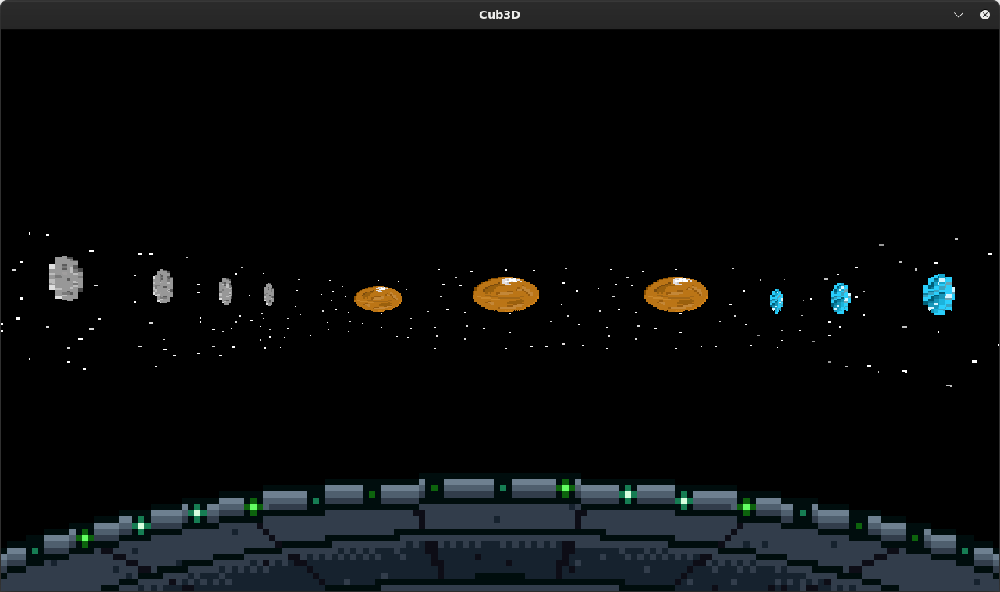

*This project has been created as part of the 42 curriculum by ecardoua, mcrenn*

# 🧊 cub3D

## 📄 Description

### 👨🏻‍🏫 What is cub3D
The cub3D project is a game inspired by Wolfenstein.
So it's a 2.5D virtual space where the player can explore. The map has walls that are cubes, with each face featuring a different texture depending on its orientation (N, S, W, E).
Players can also check their location on the map by pressing the “M” key.

To be able to navigate the map, you must specify a “.cub” file when running the project.

### 🎨 Texture/Color
The file must contain 4 paths leading to texture files; these paths represent the textures corresponding to a wall's orientation and must begin in the file with NO, SO, EA, or WE in order to be saved in the structure.

The file must also include the colors of the floor and ceiling in RGB format (3 numbers between 0 and 255, separated by commas).

```bash
# An exemple of how to use the Wall textures & floor/ceiling colors:

NO path/to/texture/north.png
SO path/to/texture/south.png
WE path/to/texture/west.png
EA path/to/texture/east.png
DO path/to/texture/door.png

F 120,75,40
C 212,187,137
```

### 🗺️ Map
You must also specify the **map**:
A map must consist of 0 and 1. For a map to be valid, it must be surrounded by 1, which represent the walls; the 0 represent the part of the map where the player can move. Any character found outside the map is an error.
In addition, the map must have a player. The player must be positioned within the map; they are named according to the direction they are facing when the map starts (N, S, W, E). If there is more than one player in the map, an error is triggered.

```bash
# A valid map Exemple:

1111111111111111111111111
1000000000DD0000000000001
10110000011111111111111111
100100000000000000000000111111111
111111111011000001110000000000001
1000000000110000011111D1101111111
11110111111111011100000010001
11110111111111011101010010001
11000000110101011100000010001
1000000000000000DD00000010001
10000000000000001101010010001
11000001110101011111011110N0111
11110111 1110101 101111010001
11111111 1111111 111111111111
```

## 📏 Instruction
In order to launch the program correctly, you must first clone the repository:
```bash
git clone https://github.com/EnzoOceanCardouat/cub3D.git
```

Next, use the `make` command to compile the minishell files and the libft library.
```bash
make all
```

After that, you can now run the program by the following command:
```bash
# Running the program, dont forget to add the file with the textures/colors/map !
./cub3D path/to/the/cube_file.cub
```


Now, you can move through the map !

To walk through the map, you can use:
- W: Move forward.
- A: Move to the left.
- S: Move to the right.
- D: Move to the back.
To turn the camera, you can use:
- RIGHT ARROW: Move to the right.
- LEFT ARROW: Move to the left.
To open the mini map, you can use:
- M: open the map until you repress it.

## 📚 Ressources
- A quick [guide](https://medium.com/@digitalpoolng/42-so-long-and-thanks-for-all-the-fish-building-your-first-2d-game-in-c-ccd24034bc8b) to register the map.
- A raycasting [tutorial](https://youtu.be/G9i78WoBBIU?si=pYP2kEnqTbRZ7isD).
- **mbirou**, **patoupen** and **mperrine** for their help on the parsing of the map.
- **alexfuen** to help me understand how to do the animation and the map.
- Claude helped with the mathematics for rendering the wall texture and the movement.

**A special thanks to all 42 students who helped us !**
